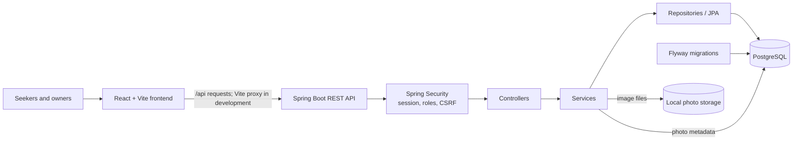

# StayMatch — Smart PG & Rental Discovery Platform

StayMatch is a full-stack application that helps people find PGs, rooms, and rental homes through preference-based search, while giving property owners tools to manage their listings. Search results are ranked with a transparent match score so seekers can compare available options more easily.

## Key features

- Separate **Seeker** and **Owner** accounts with role-based access.
- Owner tools to create, edit, view, deactivate listings, and manage listing photos.
- Search by rent range, city, area, property type, BHK, sharing type, gender preference, and amenities.
- Rule-based property match scores and ranked results.
- Listing details with rent, amenities, photos when available, and owner contact information.
- Session-based authentication, BCrypt password hashing, and CSRF protection for state-changing requests.

## Technology stack

| Layer | Technologies |
| --- | --- |
| Frontend | React 18.3.1, Vite 5.4.11 |
| Backend | Java 17, Spring Boot 3.3.5, Spring MVC, Spring Data JPA, Hibernate |
| Database | PostgreSQL |
| Security | Spring Security, HTTP sessions, BCrypt, CSRF tokens |
| Migrations | Flyway SQL migrations |
| Build tools | Maven Wrapper (Maven 3.9.8), npm |

## Architecture



The frontend sends API requests to the Spring Boot application; locally, Vite proxies `/api` to port `8080`. Controllers pass requests to services and repositories for application logic and database access. Flyway applies versioned schema migrations at backend startup. Photo metadata is stored in PostgreSQL, while image files are saved on the backend filesystem.

## Screenshots

Genuine application screenshots are not currently included. Add them here when available.

- **Seeker search:** _Screenshot placeholder_
- **Property details:** _Screenshot placeholder_
- **Owner dashboard:** _Screenshot placeholder_

## Getting started

### Prerequisites

- JDK 17
- PostgreSQL
- Node.js and npm
- Windows PowerShell (for the included local backend script)

### Configure PostgreSQL

Create a local database named `staymatch`. The default connection uses `localhost:5432` and the PostgreSQL user `postgres`. Copy the example environment file and set your local database password in `.env`:

```powershell
Copy-Item .env.example .env
```

```text
DB_PASSWORD=your_local_postgresql_password
```

The value above is a placeholder; use your own local password in the ignored `.env` file. Do not commit real credentials. To use a different database URL or username, configure Spring Boot's `SPRING_DATASOURCE_URL` and `SPRING_DATASOURCE_USERNAME` environment variables.

### Start the backend

From the project root, run the provided script. It reads `DB_PASSWORD` from `.env` and starts Spring Boot using the Maven Wrapper:

```powershell
.\run-local.ps1
```

The API runs on `http://localhost:8080`. To invoke the wrapper directly instead, set `DB_PASSWORD` in the current process environment first, then run `.\mvnw.cmd spring-boot:run`.

### Start the frontend

In a second PowerShell window:

```powershell
cd frontend
npm.cmd ci
npm.cmd run dev
```

Open <http://localhost:5173/>. The frontend's Vite configuration proxies API requests to the backend on port `8080`.

## Project structure

```text
StayMatch/
├── frontend/                   React application and Vite configuration
│   └── src/
│       ├── auth/                Registration, login, and session state
│       └── owner/               Owner dashboard and listing tools
├── src/main/java/com/staymatch/
│   ├── controller/              REST controllers
│   ├── service/                 Search, matching, account, and listing logic
│   ├── repository/              Data access
│   ├── entity/                  JPA entities
│   └── config/                  Security and photo configuration
├── src/main/resources/
│   └── db/migration/            Flyway migrations
├── src/test/java/               Backend tests
├── .mvn/wrapper/                Maven Wrapper configuration
├── run-local.ps1                Local backend launcher
└── pom.xml                      Backend dependencies and build
```

## Matching approach

Active listings are scored against the preferences supplied in a search. The implementation assigns up to 25 points to rent, 15 each to area and property type, 15 total to BHK/sharing layout, 10 to city, and 10 to amenities. Scores are normalized over the supplied preferences and rounded to two decimal places. Gender preference is an eligibility filter; it does not add score points. An over-budget listing can receive a reduced rent score when only `maxRent` is supplied, while a `minRent`/`maxRent` range filters out listings outside that interval. Results are ordered by score, then lower rent, then property ID. The percentage is a rule-based comparison, not a prediction of satisfaction.

## Limitations and future improvements

- Photos are stored on the local filesystem under `staymatch-uploads/property-photos` by default. Hosting requires persistent storage or an object-storage solution and a deployment-specific configuration.
- Owner registration is not verified or moderated. The current application has no booking, payment, messaging, or saved-listing workflow.
- A production deployment still needs a hosted database, secret management, HTTPS, persistent photo storage, and production frontend/API routing. No public deployment is documented.
- Future work could add owner verification, map-based search, saved listings, messaging, and deployment automation.

## License

No license has been specified for this project yet.

